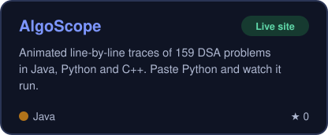
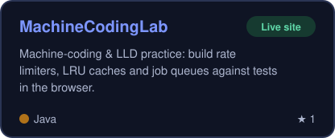
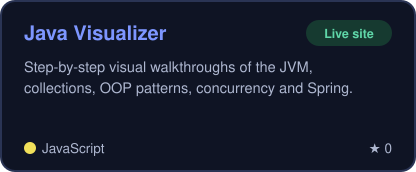
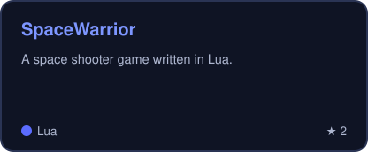
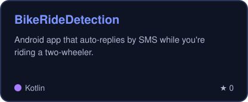
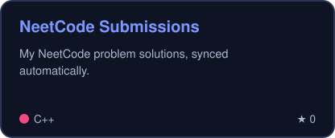
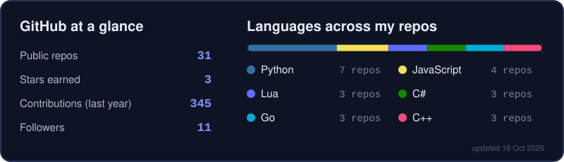

<a href="https://adityamalu.github.io/algoscope/"></a>

<p align="center">
  <a href="https://github.com/AdityaMalu"></a>
</p>

<p align="center">
  <a href="https://adityamalu.github.io/algoscope/"></a>
  <a href="https://machine-coding-lab.onrender.com"></a>
  <a href="https://adityamalu.github.io/java-visualizer/"></a>
  <a href="https://github.com/GameDevUtopia"></a>
</p>

---

### 👋 About me

```java
public class Aditya {
    String role      = "Software engineer · Game developer";
    String leading   = "President @GameDevUtopia";
    String[] code    = {"Java", "C++", "Python", "Go", "C#", "Lua", "Kotlin"};
    String building  = "Visual tools for learning DSA, LLD and Java internals";
    String practice  = "A NeetCode problem a day, synced to GitHub";
    String funFact   = "I trace algorithms by hand so you don't have to";
}
```

### 🚀 Featured projects

<table>
  <tr>
    <td width="50%"><a href="https://adityamalu.github.io/algoscope/"></a></td>
    <td width="50%"><a href="https://machine-coding-lab.onrender.com"></a></td>
  </tr>
  <tr>
    <td width="50%"><a href="https://adityamalu.github.io/java-visualizer/"></a></td>
    <td width="50%"><a href="https://github.com/AdityaMalu/SpaceWarrior"></a></td>
  </tr>
  <tr>
    <td width="50%"><a href="https://github.com/AdityaMalu/BikeRideDetection"></a></td>
    <td width="50%"><a href="https://github.com/AdityaMalu/neetcode-submissions"></a></td>
  </tr>
</table>

<details>
<summary><b>🧠 Free tools I made for interview prep</b> (click to open)</summary>

<br>

| Tool | What it's good for |
|---|---|
| [AlgoScope](https://adityamalu.github.io/algoscope/) | Watch 159 interview problems run step by step: pointers, maps, trees, graphs, DP tables. Paste your own Python and it really runs in the browser. [All problems as pages](https://adityamalu.github.io/algoscope/problems/) |
| [MachineCodingLab](https://machine-coding-lab.onrender.com) | Practice machine-coding rounds: build real components and run the tests in the browser, in Java, Python, Go or C++ |
| [Java Visualizer](https://adityamalu.github.io/java-visualizer/) | Visual walkthroughs of how the JVM, collections, concurrency and Spring work inside |
| [NeetCode submissions](https://github.com/AdityaMalu/neetcode-submissions) | My daily solutions, if you want to compare approaches |

</details>

### 🛠️ Tech stack

<p align="center">
  <br><br>
  
</p>

### 📊 Stats

<p align="center"></p>

<p align="center">
  <picture>
    <source media="(prefers-color-scheme: dark)" srcset="https://raw.githubusercontent.com/AdityaMalu/AdityaMalu/output/snake-dark.svg">
    
  </picture>
</p>

<p align="center">
  
  <sub>&nbsp;· Stats and cards refresh daily via GitHub Actions</sub>
</p>
